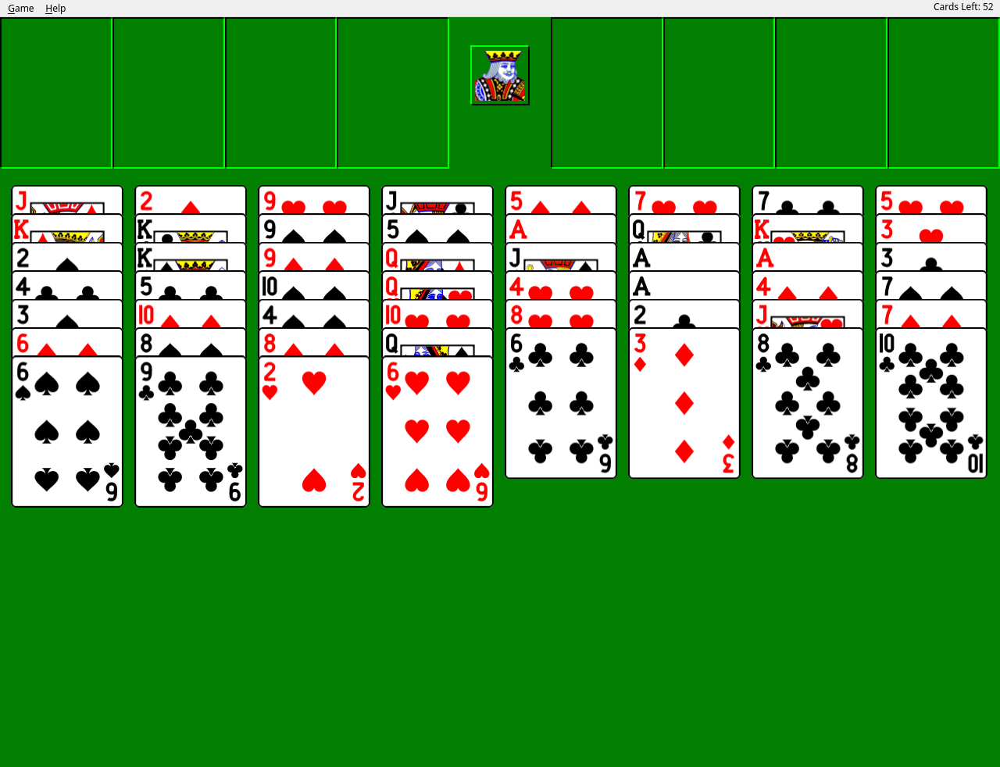
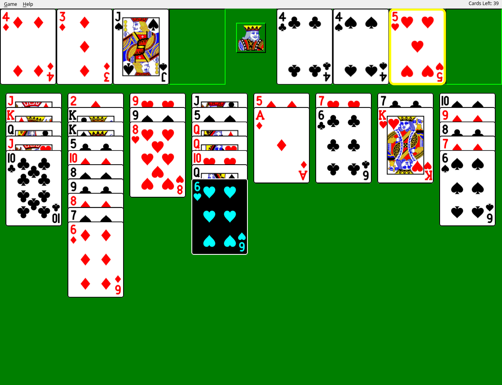
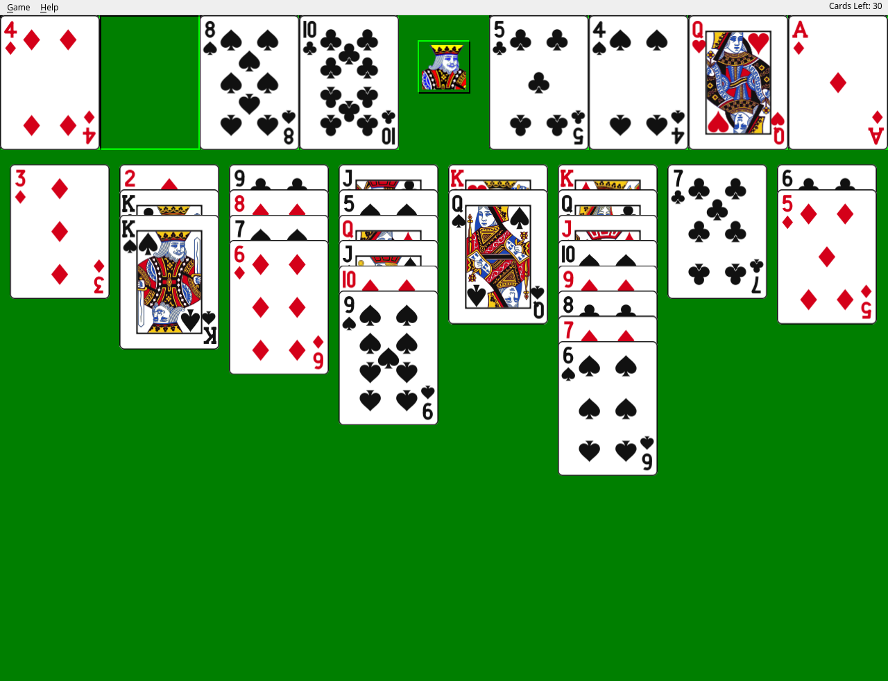
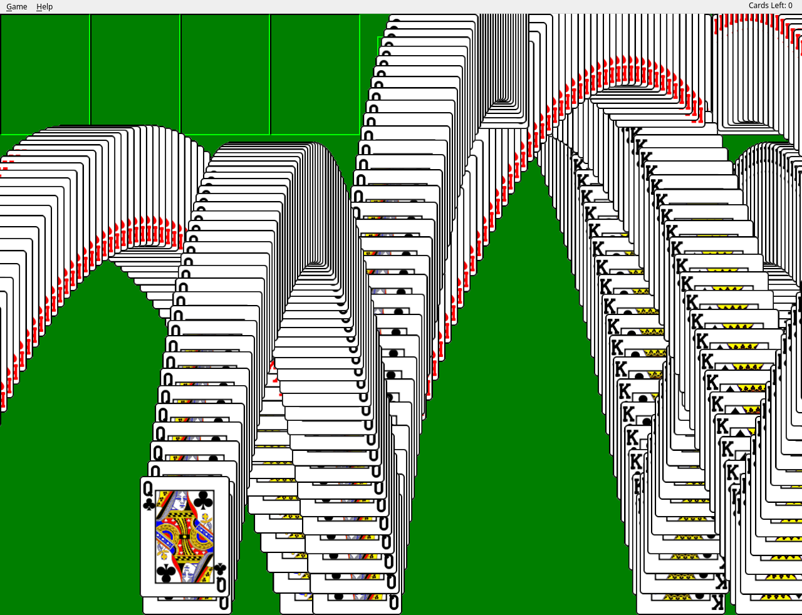

# FreeCell

A clone of Windows XP FreeCell, written in C++17 with Qt 6 Widgets.



## Goals

The aim is to bring back the XP game as it was. When the window is scaled up to
a modern resolution, the board should look like an enlarged XP screenshot.

- Layout: logical coordinates are XP's client-area pixels from a 640x480
  window. Free cells, foundations, cascades, the 71x96 cards and the king's box
  all sit where XP puts them.
- Look: `#007F00` felt, sunken slot boxes with black and `#00FF00` edges, a
  selected card shown as its color negative, and the king in the middle, who
  looks toward the mouse.
- Deals: game numbers use Microsoft's deal generator, so game #617 here is the
  same layout as game #617 in XP.
- Play: click-to-select, double-click to send a card home, safe auto-play to
  the foundations, and the bouncing-card win animation with its trails.

A few things are different on purpose, and a few XP details are not done yet.
[Differences from XP FreeCell](#differences-from-xp-freecell) lists both.

## Screenshots

Hint (F10): the suggested card is inverted and the target is outlined in
yellow.



The optional "Refined" card style, mid-game:



The XP win animation:



## Installing

Download FreeCell from the [Releases page](https://github.com/jpsutton/freecell/releases/latest):

| Platform | Download |
| --- | --- |
| Linux | `FreeCell-<version>-x86_64.AppImage`. Needs glibc 2.39 or newer (Ubuntu 24.04, Debian 13, Fedora 40 or newer, Arch). |
| Windows | `FreeCell-<version>-windows-x64.zip` (Windows 10 or 11, 64-bit) |
| macOS | `FreeCell-<version>-macos-arm64.dmg` (Apple silicon, macOS 13 or newer) |
| Android | `FreeCell-<version>-arm64-v8a.apk` (64-bit ARM, Android 9 or newer), or the [F-Droid repository](#android) |

The Windows and macOS builds are best effort. They are signed with FreeCell's
own certificate, not one bought from Microsoft or Apple, so both systems warn
you the first time you open them.

### Android

The easiest way to install and keep FreeCell up to date is FreeCell's own
F-Droid repository, which works with F-Droid, Droid-ify and Neo Store. On the
phone, add a repository with:

- Address: `https://jpsutton.github.io/freecell/fdroid/repo`
- Fingerprint: `2398539B128504C1A12494EA9ABE06E7A90C5CD7F25872B7C6D8383033AF28FD`

The page at <https://jpsutton.github.io/freecell/fdroid/> has the same
address and fingerprint, and a link that adds the repository directly. The
fingerprint belongs to the repository's own key. Check it before you trust the
repository.

You can also install the APK from the Releases page by hand. Both routes give
you the same file, signed with the same app key. Android refuses to update an
app with a build signed by a different key, so uninstall a test or debug build
first (this erases the saved game and statistics). The app does not check for
updates itself: it has no network access, and F-Droid does that job.

The Android build uses a touch layout: an app bar with undo, hint and new game,
and an overflow menu for the rest. Tap a card, then its destination, to move
it, or double-tap a card to send it to a foundation or free cell.

### Updates

The macOS app and the AppImage update themselves. Android updates through F-Droid (see above). A few seconds after FreeCell
starts, it checks the latest release. When there is a newer version, it offers
**Update**, **Skip This Version** or **Later**. **Help › Check for Updates**
checks on demand, and **Game › Options › Check for updates at startup** turns
the startup check off.

An update is checked against the SHA-256 in the release's `latest.json`. On
macOS it must also be signed with the same certificate as the installed app.
On Windows, **Update** opens the download page instead.

### macOS

The easiest way to install or update is the install script. It downloads the
latest release, checks it against the release's `SHA256SUMS` and FreeCell's
signing certificate, and copies FreeCell into `/Applications`:

```sh
curl -fsSL https://raw.githubusercontent.com/jpsutton/freecell/main/scripts/install-macos.sh | bash
```

Files downloaded with `curl` aren't quarantined, so FreeCell opens without a
Gatekeeper prompt. Run the same command again to update.

If you download the `.dmg` in a browser instead, macOS says Apple could not
verify that FreeCell is free of malware. After the first attempt to open it, go
to **System Settings › Privacy & Security** and click **Open Anyway**. Or clear
the quarantine from a terminal:

```sh
xattr -dr com.apple.quarantine /Applications/FreeCell.app
```

### Windows

Unzip the folder anywhere and run `FreeCell.exe`. If SmartScreen says "Windows
protected your PC", click **More info**, then **Run anyway**.

### Linux

Make the AppImage executable and run it:

```bash
chmod +x FreeCell-*-x86_64.AppImage
```

```bash
./FreeCell-*-x86_64.AppImage
```

### Checking a download

Every release file comes with a GPG signature, and the release includes a
signed `SHA256SUMS`. The release key is
[`packaging/freecell-signing-key.asc`](packaging/freecell-signing-key.asc),
fingerprint `CE91 35AD 625D FAF3 378D  4159 20A7 4E15 59D0 94FA`.

```bash
gpg --import freecell-signing-key.asc
```

```bash
gpg --verify SHA256SUMS.sig SHA256SUMS && sha256sum --check --ignore-missing SHA256SUMS
```

The macOS app and `FreeCell.exe` are also code-signed with
[`packaging/freecell-codesign.crt`](packaging/freecell-codesign.crt), a
self-signed certificate for "FreeCell (jpsutton)" with SHA-256 fingerprint
`FA:94:62:BA:7E:F9:EE:D6:6A:D5:92:C5:13:29:F3:30:0E:F1:40:CF:B5:6E:CD:5C:92:C0:1C:09:90:99:8C:47`.

## Building from source

Requirements: CMake 3.16 or later, a C++17 compiler, and Qt 6 with the
`Widgets` and `Svg` modules.

A build from source doesn't check for updates. To build the update checker in,
as the release builds do, configure with `-DFREECELL_UPDATER=ON` (it also needs
Qt's `Network` module).

```bash
cmake -S . -B build
cmake --build build
./build/freecell
```

Run the logic tests with either of these:

```bash
./build/gametest
ctest --test-dir build
```

## Playing

On first start the window opens at 1280x960 (twice XP's 640x480) on a random
Microsoft deal between #1 and #32000. If you quit during a game, the next start
resumes that game.

| Action | How |
|---|---|
| Move cards | Click a pile to select it (its top card turns inverted), then click the destination. The longest run that fits moves; onto an empty cascade, that is the longest movable run. Click the selection again to deselect. You can also drag a card, or a valid run of cards, onto a pile. |
| Quick move | Double-click a cascade's bottom card or a free-cell card. It goes to a foundation if it can. Otherwise a cascade card goes to the first empty free cell, and a free-cell card goes to a matching cascade (non-empty cascades first, then empty ones). |
| Take a card back | Click or drag the top card of a foundation onto a free cell or a cascade. |
| Auto-play | After each move, cards that are safe to play go to the foundations on their own. |

### Menu

| Item | Key | Notes |
|---|---|---|
| Game > New Game | F2 | Deals a random shuffle (not an MS game number). The title shows it as `Random XXXXXXXX`. |
| Game > Select Game... | F3 | Plays a Microsoft deal, 1 to 1000000. |
| Game > Restart Game | | Re-deals the current game. Does not ask to resign or record a loss. |
| Game > Statistics... | F4 | Session and all-time won/lost, percentage, current and longest streaks. The Clear button resets both. |
| Game > Options... | F5 | "Play animations", "Display messages", "Card style" (Classic or Refined; see [Card art](#card-art)) and, in release builds, "Check for updates at startup". |
| Game > Undo | Ctrl+Z | Unlimited undo. One undo also reverses the auto-play moves that followed it. |
| Game > Hint | F10 | Highlights the suggested card(s) and outlines the target in yellow. |
| Game > Exit | | Saves the game in progress and quits. |
| Help > Check for Updates... | | Release builds only. See [Updates](#updates). |
| Help > About FreeCell | | Shows the version. |

The "Cards Left" count shows in the top-right corner of the menu bar, and the
window title shows the game number.

Starting a new game or selecting a game while a game is in progress asks "Do
you want to resign this game?" and records a loss if you say yes. With "Display
messages" turned off, the game skips that prompt (and the win, stuck and
no-hint messages) and resigns without asking. Closing the window never
resigns: it saves the game, and the next start resumes it with its undo
history.

Winning plays the XP bouncing-card animation. Click or resize the window to
skip it.

## Rules as implemented

- 8 cascades, 4 free cells, 4 foundations. The deal goes round-robin, so
  cascades 0 to 3 get 7 cards and 4 to 7 get 6.
- Cascades build down in alternating colors. Foundations build up by suit from
  the ace. Any card can go to an empty cascade.
- Run length follows the standard supermove formula:
  `(empty free cells + 1) * 2^(empty cascades)`. When the target is an empty
  cascade, that cascade does not count.
- Auto-play sends a card to a foundation only when it is safe: aces and twos
  always, and any other card only when both opposite-color foundations already
  hold the card one rank below it.
- The top card of a foundation can move back to a free cell or a cascade, but
  not to another foundation. Auto-play skips a card you took back until you put
  it on a foundation yourself, so it does not jump straight back.
- "Sorry, there are no more moves" appears when no legal move is left. Taking a
  card back off a foundation does not count as a move for this check, and hints
  never suggest it.

## Differences from XP FreeCell

Some changes are deliberate. Others are XP details that this clone does not
match yet.

### On purpose

- Closing the window saves the game, and the next start resumes it. XP asks
  you to resign when you exit and counts a loss.
- You can move a card back off a foundation. XP never lets a card leave a
  foundation.
- Undo is unlimited. XP allows one level.
- New Game (F2) deals a random shuffle instead of a random MS game number.
  Select Game (F3) still plays the numbered Microsoft deals.
- The window opens at 1280x960, twice XP's size, and the whole board scales
  with the window width.
- Release builds check GitHub for new versions and can update themselves.
- There is an optional "Refined" card style with softer colors and thinner
  borders. The default "Classic" style uses XP's colors.

### Not matched yet

- The king does not change expression when you win.
- There is no "Move column or move single card?" prompt when moving onto an
  empty cascade. A selected pile moves its longest movable run; a dragged run
  moves as dragged.
- Widening the window scales the whole board. XP instead keeps card size and
  spreads the cascades apart.
- XP's options ("Display messages on illegal moves", "Quick play",
  "Double-click moves card to free cell") are not all here. This clone has
  "Play animations", "Display messages" and "Card style", and illegal moves
  fail silently.
- Card faces keep XP's layout and colors but are vector drawings, not XP's
  bitmaps. Court cards use public-domain art, not XP's own court art. The ace
  of spades is a large plain spade, not XP's ornate one.

## Code layout

| Path | Contents |
|---|---|
| `src/game.h`, `src/game.cpp` | Qt-free game model in namespace `fc`: the MS deal generator, move validation, undo, auto-play, legal move list and hint scoring. Built as the static library `fccore`. |
| `src/board.h`, `src/board.cpp` | `Board` widget: hit testing, mouse handling (click, drag, double-click), move animation, hint display, the win animation, and restoring a saved game. |
| `src/board_paint.cpp` | `Board` geometry and painting: layout, card rendering and caching, slots, the king, and the main paint routine. |
| `src/board_consts.h` | Logical layout constants (card size, board width, margins). |
| `src/mainwindow.h`, `src/mainwindow.cpp` | Menus, dialogs, Options, game start, resign, save and resume, and the status text. |
| `src/stats.h`, `src/stats.cpp` | Win/loss statistics and the Statistics dialog. |
| `src/updater.h`, `src/updater.cpp` | The update checker (release builds only): reads `latest.json`, downloads, verifies and installs updates. |
| `src/main.cpp` | Entry point. |
| `tests/gametest.cpp` | Logic tests for `fccore` (no Qt needed). |
| `assets/faces/faithful/`, `assets/faces/refined/`, `assets/cards.qrc` | SVG card faces for the two card styles, compiled into the binary under `:/faces/<style>/`. |
| `assets/king-spades-crop.svg` | The king between the free cells and the foundations, bundled as `:/art/king.svg`. |
| `assets/cards/` | Source SVGs for the court card art (the full upstream deck). Not bundled. |
| `tools/make_card_faces.py` | Generator for the SVG faces. |
| `tools/make_icons.py` | Generator for the app icon in `packaging/` (from the king of spades face). |
| `packaging/` | Desktop entry, Info.plist, icons, and the public signing key and certificate. |
| `scripts/install-macos.sh` | The macOS install script. |
| `scripts/ci/` | Packaging and signing scripts for the workflows in `.github/workflows/`. |
| `docs/screenshots/` | The screenshots in this README. |

### Model details

- Cards are integers 0 to 51: `rank = c / 4` (0 is ace, 12 is king) and
  `suit = c % 4` (clubs, diamonds, hearts, spades). This matches the encoding
  of MS FreeCell.
- `fc::msDeal(n)` is the Microsoft linear congruential generator
  (`seed = seed * 214013 + 2531011`, using bits 16 to 30). Card `k` of the
  result goes to cascade `k % 8`.
- A `Move` is `from`/`fromIdx` to `to`/`toIdx` with a `count`. Auto-play moves
  have `chained = true`, so `Game::undo()` keeps popping moves until it has
  reversed a move that is not chained.
- `Game` keeps a 52-bit mask of cards taken back off a foundation, which
  auto-play skips. Each `Move` records the mask from before it was applied, so
  undo restores it exactly.
- `legalMoves()` only tries the first empty free cell and the first empty
  cascade, so equivalent moves are not listed twice. It also skips moving a
  whole cascade into an empty cascade. It never lists moves off a foundation.
- `hint()` scores each legal move and picks the best: foundation 100, free cell
  to cascade 60, cascade to cascade 50 (+15 if it empties the source column,
  +10 if it exposes a card that can go to a foundation), free cell to empty
  cascade 20, to a free cell 10, cascade to empty cascade 5. It skips the move
  that would undo the last move.

### Rendering details

- The board uses XP's client-area pixels as logical units (632 wide, as in a
  640x480 XP window) and scales uniformly to the widget width. Positions match
  XP: free cells at x 0, 71, 142 and 213, foundations from x 348, cascades at
  `7 + 78 * i` starting at y 106. Cascade card spacing shrinks from 18 (the XP
  spacing) down to 9 units to fit the longest column in the window height.
- Free cells and foundations are separate sunken 71x96 boxes (black top and
  left edges, `#00FF00` bottom and right edges) on `#007F00` felt, like XP.
  There is no line across the board.
- The king sits in a raised 38x38 box at (297, 18). His art is
  `assets/king-spades-crop.svg` (`:/art/king.svg`), a crop of the king of
  spades court art, drawn 32x32 and mirrored when the mouse is on the left
  half of the board. Qt SVG ignores the file's `clipPath`, so the art is
  cropped by rendering it into a pixmap of exactly the icon's size.
- Card faces are SVGs drawn on XP's 71x96 card grid. `QSvgRenderer`
  renders each one at the current scale and device pixel ratio, so faces stay
  sharp at any window size. Parsed faces and rendered pixmaps are cached per
  card. The pixmap cache clears when the scale changes, and both caches clear
  when the card style changes.
- A selected pile shows its top card as its color negative
  (`QImage::invertPixels`), like XP. A hint inverts the whole suggested run.
- The win animation draws onto an off-screen pixmap and does not clear it, so
  each card leaves a trail, like XP.

### Persistence

`QSettings` with organization `freecell` and application `FreeCell` (on Linux,
`~/.config/freecell/FreeCell.conf`) stores:

- `options/animations`, `options/messages`, `options/cardStyle` (`faithful`
  or `refined`)
- `stats/wins`, `stats/losses`, `stats/streak`, `stats/maxWins`,
  `stats/maxLosses`
- `saved/name`, `saved/deal`, `saved/moves`: the game in progress at exit, as
  its title, its 52-card deal order and its move history. On the next start the
  moves are replayed onto the deal, and the saved game is then removed.
- `updates/check` (the startup check is on unless this is `false`) and
  `updates/skip` (the version the user chose to skip)

Session statistics live in memory only.

## Tests

`gametest` checks:

- The first row of MS games #1 and #617 against the known layouts.
- That deals for several game numbers are full permutations of the deck.
- Basic apply, hint and undo on game #1, and the starting supermove limit (5).
- A hint-driven playthrough of games 1 to 200 (up to 300 moves each, with
  auto-play), checking that no cards are lost or duplicated.
- Taking a card back off a foundation: it is allowed to a free cell but not to
  another foundation, auto-play does not send it straight back, replaying the
  move history reproduces the position, and undo puts the card back.

## Development and releases

Changes go through two branches:

1. Each fix or feature gets its own branch, cut from `staging`, and a pull
   request into `staging`. The `checks` workflow runs on it: shellcheck,
   actionlint, the desktop entry, and a Linux build with the logic tests.
2. When `staging` holds what the next release should have, bump the version in
   `CMakeLists.txt` (`project(freecell VERSION x.y.z ...)`) and open one pull
   request from `staging` into `main`. Besides the checks, it runs the `build`
   workflow, which builds the AppImage, the Windows zip and the macOS app. The
   AppImage must build; Windows and macOS are best effort.
3. Merge it with **Create a merge commit**. The `release` workflow then takes
   that pull request's build without rebuilding, signs it, tags `v<version>`
   and publishes the GitHub Release.

The release workflow signs with these repository secrets:

| Secret | What it is |
| --- | --- |
| `FREECELL_GPG_KEY` | The armored GPG private key (no passphrase) that signs every file and `SHA256SUMS` |
| `FREECELL_CODESIGN_P12` | The code-signing certificate and its key, as a base64 PKCS#12 file. Signs the macOS app (`codesign`) and `FreeCell.exe` (Authenticode, with `osslsigncode`). |
| `FREECELL_CODESIGN_PASSWORD` | The PKCS#12 file's password |
| `FREECELL_APK_KEYSTORE`, `FREECELL_APK_KEYSTORE_PASS` | The Android app signing key (base64 PKCS#12) and its password. Signs the APK. Android refuses an update signed with a different key, so this key must never change. |
| `FREECELL_FDROID_KEYSTORE`, `FREECELL_FDROID_KEYSTORE_PASS` | The F-Droid repository's own signing key (base64 PKCS#12) and its password. Its fingerprint is what users check when they add the repository. |

The release workflow also publishes the F-Droid repository to the `gh-pages`
branch under `/fdroid`, with `scripts/ci/fdroid-repo.sh`. Each release adds its
APK and rewrites the branch as one fresh commit, so it never grows past a few
APKs. The app's listing text is in `packaging/android/fdroid/`.

The public halves are in `packaging/`. Keep the private keys: a new code-signing
certificate would change the macOS app's identity, so the install script and
installed copies would refuse updates signed with it.

`release.yml` also has a manual dry run (Actions › release › Run workflow). It
signs the newest build of the chosen branch and uploads the result as an
artifact, without tagging or releasing.

## Card art

The faces in `assets/faces/` come from `tools/make_card_faces.py` (Python 3,
no other dependencies):

```bash
python3 tools/make_card_faces.py
```

Both card styles share one design, laid out on XP's 71x96 card grid:

- The corner index sits where XP's does. Rank glyphs are 2-unit strokes
  modeled on XP's bitmap font. The bottom-right copy is rotated 180 degrees.
- Pips are smooth versions of XP's suit shapes on XP's pip grid (columns
  x 15, 28 and 41). Bottom-half pips are flipped vertically, as in XP.
- Court cards (J, Q, K) use the four flat color layers inside the inner frame
  of the public-domain "Vector Playing Cards" SVGs in `assets/cards/` (based
  on Byron Knoll's vector-playing-cards; see `assets/cards/README-upstream.md`).
  The script recolors them to the style's palette and places them in an
  XP-style frame. Jacks and queens are mirrored so they face the same way as
  XP's. Qt SVG does not support `clipPath`, so the art is trimmed by painting
  the card white outside the frame instead.

The styles differ only in color and border:

| Style | Red | Black | Yellow | Blue | Border | Corner radius |
|---|---|---|---|---|---|---|
| Classic (`faithful`) | `#FF0000` | `#000000` | `#FFFF00` | `#0000FF` | 1 unit | 3 units |
| Refined (`refined`) | `#D40019` | `#111111` | `#F6CB16` | `#1C47B8` | 0.75 unit | 3.5 units |

## License

The code is released under the [MIT License](LICENSE). The court card art in
`assets/cards/` and the faces built from it are public domain (see
`assets/cards/README-upstream.md`).

FreeCell and Windows are trademarks of Microsoft. This project is an
independent fan recreation and is not affiliated with Microsoft. It contains
no Microsoft code or bitmaps.
